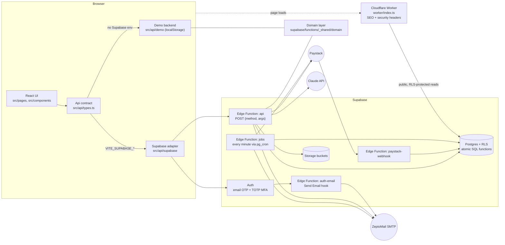

# Architecture

JustGifter is a single-page React app, a thin Cloudflare Worker in front of it, and a Supabase backend (Postgres, Auth, Storage, Edge Functions, Cron). Business rules live in one pure-TypeScript **domain layer** that both the browser demo backend and the Edge Functions import.



## The pieces

| Piece | Location | Responsibility |
|---|---|---|
| UI | `src/pages`, `src/components`, `src/app` | Screens, layouts, route guards. Talks only to the `Api` interface. See [FRONTEND.md](FRONTEND.md). |
| API contract | `src/api/types.ts` | The `Api` interface and every view type. The single seam between UI and backend. See [API.md](API.md). |
| Demo backend | `src/api/demo` | Full in-browser implementation of `Api` on a localStorage "database". It enforces the same rules as production, so you can try every journey without accounts. |
| Supabase adapter | `src/api/supabase` | Maps `Api` calls to Supabase Auth plus `POST /functions/v1/api`. Holds no business logic. |
| Domain layer | `supabase/functions/_shared/domain` | Pure functions and types for pricing, delivery feasibility, eligibility, state machines, holds, ledger, tokens, recommendations, templates and letters. See [DOMAIN.md](DOMAIN.md). |
| `api` Edge Function | `supabase/functions/api` | RPC entry point. Resolves the caller from the JWT, applies rate limits, and dispatches to handler modules. |
| `paystack-webhook` Edge Function | `supabase/functions/paystack-webhook` | Checks the HMAC signature, re-verifies with Paystack, and commits payments and refunds idempotently. |
| `jobs` Edge Function | `supabase/functions/jobs` | Runs every minute. Expires holds and payments, runs due jobs with backoff, reconciles stuck payments and delivers the email outbox. See [OPERATIONS.md](OPERATIONS.md). |
| `auth-email` Edge Function | `supabase/functions/auth-email` | Supabase Auth "Send Email" hook. Sends branded sign-in and security emails through SMTP. |
| Shared server code | `supabase/functions/_shared` | DB client, auth, HTTP helpers, repositories, commerce workflows, notifications, Paystack and Claude adapters, email templates. |
| Database | `supabase/migrations` | Schema, RLS, and atomic SQL for holds, payment commits and job claiming. See [DATABASE.md](DATABASE.md). |
| Edge Worker | `worker/index.ts` | Runs before static assets. Injects SEO metadata and HTML snapshots for public pages, sets CSP and security headers, and marks private routes `no-store` and `noindex`. |

## Choosing the backend

`src/api/index.ts` resolves the backend once, at first use:

- If `VITE_SUPABASE_URL` and `VITE_SUPABASE_ANON_KEY` are both set, and `VITE_DEMO_MODE` isn't `"true"`, the app uses the **Supabase adapter**.
- Otherwise it uses the **demo backend** (`api.mode === "demo"`). The DEMO panel, personas and the sandbox payment page (`/pay/demo/:reference`) appear only in this mode.

End-to-end tests always force demo mode (see [TESTING.md](TESTING.md)).

## Request lifecycle (production)

1. The UI calls a method on `Api`, usually through a TanStack Query hook in `src/lib/api-hooks.ts`.
2. The adapter sends `POST /functions/v1/api` with `{ method, args }`, the user's access token (or the anon key), and any order-access tokens the guest holds in `sessionStorage`.
3. `api/index.ts`:
   - resolves the **caller** from the JWT (`_shared/auth.ts`). Roles and vendor id always come from `profiles` and `vendor_staff`, never from the client.
   - applies a per-instance **rate limit** to abuse-prone methods.
   - calls the handler.
4. The handler **authorises the caller** itself (`requireUser`, `requireRole`, `vendorCtx`, `hosted`, and so on). It then runs domain functions and reads and writes Postgres with the service role. RLS still blocks direct table access from browsers.
5. The response is `{ data }` or `{ error: { code, message } }`, always sent with `Cache-Control: no-store`. Unexpected errors are logged with a short correlation id, and that id is shown to the user.

## Payment lifecycle

```mermaid
sequenceDiagram
  participant B as Buyer (browser)
  participant A as api function
  participant P as Paystack
  participant W as paystack-webhook
  participant DB as Postgres
  participant J as jobs (cron)

  B->>A: createCheckout(draft)
  A->>DB: preview + create stock holds (create_stock_hold)
  A->>DB: insert order (awaiting_payment), gift, payment
  A->>P: initialize transaction
  A-->>B: paymentUrl, reference, orderAccessToken
  B->>P: pays on hosted page
  P->>W: charge.success (signed)
  W->>P: verify transaction
  W->>DB: commit_verified_payment (idempotent; decrement stock, convert holds)
  W->>DB: ledger entries, move to acceptance / schedule reveal
  B->>A: getPaymentStatus (polls /checkout/confirm/:ref)
  J->>P: verify any payment pending > 2 min (missed webhooks)
  J->>DB: run reveal / claim / timeout jobs, deliver outbox
```

Key guarantees:

- **No overselling.** Holds and stock changes happen inside SQL functions that take row locks in a stable order.
- **Idempotent payments.** Every webhook event id is recorded in `webhook_events`. Replays return `duplicate`, and ledger entries carry idempotency keys.
- **Late payments.** A payment that arrives after its hold lapsed, when no units are left, is recorded as `paid` and escalated as a `conflict`. It is never oversold.

## Why one domain layer

Files in `_shared/domain` use explicit `.ts` import suffixes and no runtime-specific APIs, so Deno (Edge Functions) and Vite (browser, through the `@domain` alias) can both import them. A rule such as "address-unknown gifts can't be perishable" therefore changes in one place and is tested once (`domain.test.ts`). It then applies identically in the demo and in production.

## Public rendering

The Worker (`run_worker_first` in `wrangler.jsonc`) intercepts every route except static assets. Public pages get a `<title>`, description, canonical URL, Open Graph tags, JSON-LD and a crawlable HTML snapshot. This covers the home page, shop, products, stores and public occasion pages. The Worker fetches the data from Supabase's public REST endpoints or the `api` function using the anon key.

Public HTML is cached briefly at the edge (`s-maxage=300`). The Worker also serves `/robots.txt` and `/sitemap.xml`.

Private routes never get that treatment. Instead they get `Cache-Control: no-store, private`, `X-Robots-Tag: noindex, nofollow` and `Referrer-Policy: no-referrer`, so reveal tokens can't leak. Private routes are `/g/`, `/l/`, `/preview/`, `/checkout`, `/account`, `/orders`, `/pay/`, `/vendor`, `/admin`, `/events`, `/mfa`, `/signin` and `/cart`. The list lives in `PRIVATE` in `worker/index.ts`; details are in [SECURITY.md](SECURITY.md).
