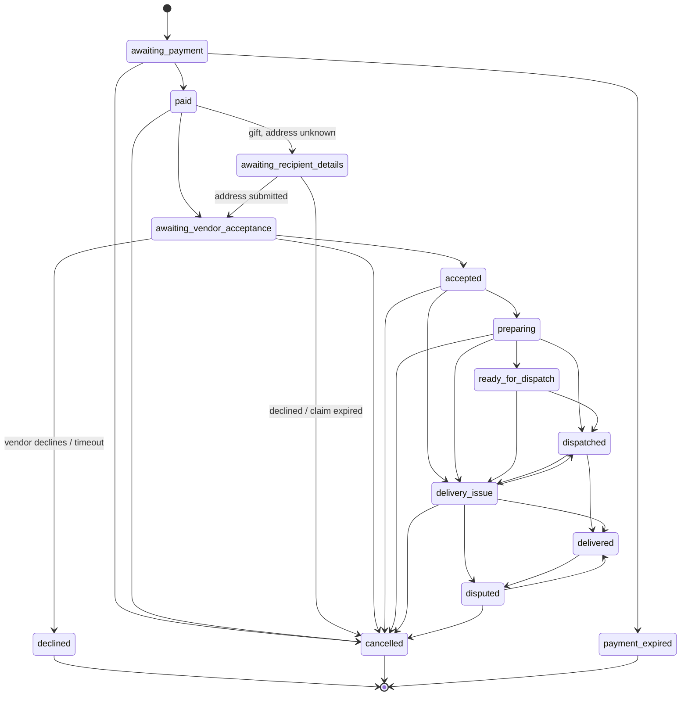

# Business rules (domain layer)

Every rule that affects money, stock, delivery promises or privacy lives in [`supabase/functions/_shared/domain`](../supabase/functions/_shared/domain). These modules are pure TypeScript with no I/O. The browser demo imports them through the `@domain` alias and the Edge Functions import them directly, so there is exactly one copy of each rule.

| Module | What it decides |
|---|---|
| `types.ts` | Every domain entity and enum. Read this first. |
| `catalog.ts` | Launch settings (`DEFAULT_SETTINGS`), delivery zones, occasions, categories, interests, relationships, event types, budget bands. |
| `money.ts` | Integer minor units (kobo), basis-point maths, formatting. |
| `time.ts` | Time-zone-correct date arithmetic (`Africa/Lagos`). |
| `delivery.ts` | Preparation start, earliest delivery, date feasibility, deliverable dates, acceptance deadline. |
| `pricing.ts` | Line building, the price breakdown (`quote`), the platform/vendor split (`settlementFor`). |
| `eligibility.ts` | Whether a checkout can proceed, with one plain-language issue per problem. |
| `states.ts` | State machines, status labels and tones, fulfilment milestones. |
| `wishlist.ts` | Holds, sellable units, wishlist remaining quantity, late-payment resolution. |
| `ledger.ts` | Append-only ledger entries for payments and refunds, vendor balance. |
| `tokens.ts` | Random tokens, SHA-256, OTPs, order references, constant-time compare, contact masking. |
| `recommend.ts` | Gift assistant: preference extraction, filtering, scoring, limiting-constraint messages. |
| `templates.ts` | Occasion-page templates, palettes, fonts, sections, motion presets, design validation. |
| `letters.ts` | Digital letters: tones, limits, rule-based composer, send validation, letter state machine. |
| `letter-studio.ts` | Letter design (themes, flowers, light, details), moments and their limits, music-link parsing. |

> **Rule of thumb:** if a backend handler contains an `if` that changes money, stock or what someone may see, it probably belongs in this layer, with a test in `domain.test.ts`.

## Platform settings

`DEFAULT_SETTINGS` in `catalog.ts` is overridden in production by the `platform_settings` row. Several values are placeholders awaiting a founder decision (see [DECISIONS.md](DECISIONS.md)).

| Setting | Default | Used for |
|---|---|---|
| `currency` / `timezone` | `NGN` / `Africa/Lagos` | All prices and all date maths. |
| `holdMinutes` | 10 | Checkout and wishlist stock holds; payment expiry. |
| `claimWindowHours` | 72 | How long a recipient has to add an address. |
| `acceptanceHours` | 4 | Operating hours a vendor has to accept a paid order. |
| `commissionBps` | 1000 (10%) | Commission on item value. |
| `buyerFeeBps` | 0 | Buyer-facing platform fee. |
| `taxIncludedInPrices` | `true` | Prices are VAT-inclusive, so no tax line is added. |
| `maxAdvanceDays` | 90 | How far ahead deliveries, reveals and letters can be scheduled. |
| `adjustmentApprovalThreshold` | 5,000,000 kobo (₦50,000) | Refunds above this need an admin. |

## Money

- All amounts are integers in **minor units** (`Minor`, kobo). Never use floats. Percentages are **basis points**, applied with `applyBps`.
- `quote()` computes the total as items + wrapping + personalisation + delivery − discount + platform fee + tax. Tax is 0 while prices are VAT-inclusive.
- `settlementFor()` splits a paid order:
  - **commission** = (items − discount) × `commissionBps`. Wrapping, personalisation and delivery pass through to the vendor.
  - **vendorPayable** = total − platform fee − commission.
  - **platformRevenue** = commission + platform fee.
- The server **always re-prices**. Prices in the cart are display snapshots; a stale `expectedUnitPrice` produces `PRICE_CHANGED`.

## Ledger

The ledger (`ledger.ts`, table `ledger_entries`) is **append-only**. A database trigger rejects updates and deletes. Corrections are compensating entries. Each entry has an idempotency key derived from its business event, so replays can't double-post.

| Event | Entries (idempotency key) |
|---|---|
| Payment verified | `charge` (`charge:<order>`), `platform_commission` (`commission:<order>`), `vendor_payable` (`payable:<order>`) |
| Refund completed | `refund` (`refund:<refund>`), `commission_reversal`, `vendor_payable_reversal`, split in proportion to the original settlement |
| Other | `payout`, `adjustment` |

Vendor payouts become eligible after delivery plus a **7-day dispute window** (`DISPUTE_WINDOW_DAYS` in `api/vendor.ts`). The code records payables only. It never describes funds as held in escrow.

## Stock and holds

- **Sellable units** = variant stock − active, unexpired holds (`sellableUnits`).
- Checkout creates a hold per line for `holdMinutes`. Wishlist purchases first hold the wishlist item (`holdWishlistItem`), so two guests can't buy the same wish.
- Stock is decremented only when a **verified payment commits** (`commit_verified_payment` in SQL). Holds then become `converted`.
- Holds that lapse become `expired` (`expire_holds_and_payments`, run every minute).
- **Late payment:** if the hold lapsed and the units are gone, the order is still marked `paid`, a support case is opened, and the buyer is told. Stock is never oversold (`resolveLatePayment`, AC 21).
- Cancelling before dispatch restocks the items, and restores wishlist quantity only while the item is still wanted (`restock_order`).

## Delivery feasibility

`delivery.ts` turns a vendor's operating calendar into concrete promises:

1. **Preparation start.** Today if it's an open day and before the order cut-off; otherwise the next open day at opening hour.
2. **Ready time.** Preparation start plus the product's `prepHours`.
3. **Same day.** Allowed only when the zone's lead time is 0 and at least 2 hours of the delivery window remain once the item is ready.
4. **Candidate date.** Ready date plus the zone lead days, moved forward past closed days, blackout dates and days at capacity, up to `maxAdvanceDays`.

Failures produce a code with a plain-language message. The codes are `zone_unsupported`, `before_earliest`, `closed_day`, `blackout`, `at_capacity`, `too_far_ahead` and `no_dates`.

`acceptanceDeadline()` counts **operating hours** only. An order paid at 9 pm gets its 4 hours the next working morning.

## Checkout eligibility

`checkEligibility()` returns every issue at once, so the UI can show them together:

| Code | Meaning |
|---|---|
| `EMPTY_CART` | Nothing to buy. |
| `MIXED_VENDORS` | One vendor per checkout (launch scope). |
| `VENDOR_UNAVAILABLE` | The vendor isn't approved or is suspended. |
| `STOREFRONT_PAUSED` | Storefront orders while the store is paused. |
| `LISTING_UNAVAILABLE` | The listing isn't active. |
| `VARIANT_NOT_FOUND` | The variant doesn't exist. |
| `QUANTITY_INVALID` | The quantity isn't between 1 and 20. |
| `INSUFFICIENT_STOCK` | Not enough sellable units after holds. |
| `PRICE_CHANGED` | The price differs from what the buyer saw. |
| `PERSONALISATION_REQUIRED` | Required personalisation text is missing. |
| `PERSONALISATION_TOO_LONG` | The text exceeds the listing's limit. |
| `ZONE_UNSUPPORTED` | The vendor doesn't deliver to the zone. |
| `DATE_INFEASIBLE` | The requested date can't be met. |
| `ADDRESS_UNKNOWN_NOT_ALLOWED` | The item can't be sent without an address. |

**Address-unknown gifts** are allowed only for items that are safe to cancel if the recipient never answers: `!perishable && !highlyCustomised && returnEligible` (`canSendWithoutAddress`).

## State machines

All transitions go through `assertTransition(TABLE, from, to)`, which throws `TransitionError` on an illegal jump in both runtimes. User-facing labels are in `states.ts`. Each stage gets its own wording, never "Completed" for everything.

### Order

What happens after a verified payment (`processVerifiedPayment` in `_shared/commerce.ts`):

1. Ledger entries are posted and the reconciliation row is marked `matched`.
2. If it's a gift with an unknown address, the order moves to `awaiting_recipient_details`. Otherwise it moves to `awaiting_vendor_acceptance`, gets an `acceptBy` deadline, an `acceptance_timeout` job, and a vendor email.
3. The gift's reveal becomes `scheduled`. It is dispatched now if `revealAt` has passed, or later by a `reveal_notification` job.
4. A receipt email is queued for the buyer.

### Other entities

| Entity | Transitions (`states.ts` / `letters.ts`) |
|---|---|
| **Refund** | `requested → approved / rejected`; `approved → submitted`; `submitted → completed / failed`; `failed → submitted` (retry). |
| **Reveal** | `draft → scheduled / available`; `scheduled → available` (and rescheduled); `available → opened`. |
| **Claim** (address-unknown gift) | `pending → submitted / declined / expired / needs_sender_approval`; `needs_sender_approval → submitted / declined / expired`. `not_required` when the sender gave the address. |
| **Event** | `draft → published / archived`; `published → closed / draft / archived`; `closed → published / archived`. |
| **Vendor** | `draft → submitted → under_review → approved / rejected / needs_information`; `needs_information → submitted` (applicant replies), `→ under_review` (team resumes), or `→ rejected`; `approved ↔ suspended`. |
| **Letter** | `scheduled → sent / cancelled / failed`; `sent → opened`; `failed → sent` (retry). |
| **Listing** | `draft`, `pending_review`, `active`, `rejected`, `archived`. Material edits return an active listing to review. |
| **Hold** | `active → converted / released / expired`. |
| **Payment** | `pending → successful / failed / expired`. |

## Gifts and reveals

- A gift link (`/g/:token`) is a 32-byte random token. **Only its SHA-256 is stored.** It is minted when the reveal is dispatched, so a gift cancelled before then never had a working link.
- Notification subjects and bodies never name the item, the price or an anonymous sender (GFT 06, AC 07).
- For address-unknown gifts the recipient verifies with a code sent to the contact the sender used, then has `claimWindowHours` to submit an address. A reminder is sent 24 hours before the deadline. When the window ends the order is cancelled and refunded (`claim_expiry`).
- An address outside the quoted zone becomes `needs_sender_approval` rather than silently changing the price.
- The sender can preview the exact reveal with a separate preview token (`/preview/gift/:token`).

## Digital letters

Letters can be sent on their own or carried as a gift's message. Both are limited to `LETTER_MAX_CHARS` = 2,000 characters.

- Tones: `heartfelt`, `romantic`, `playful`, `appreciative`, `formal`. Revisions: `shorter`, `warmer`, `like-me`.
- `validateLetterSend()`: the recipient name is at most 80 characters, the email must be valid, the body can't be empty, and the signature is at most 60 characters. A scheduled time must be at least 5 minutes ahead and within `maxAdvanceDays`. `clientRef` makes retries idempotent.
- `LETTERS_PER_DAY` = 20 per sender.
- `cleanLetterBody()` strips control and bidi-override characters.
- AI drafts must pass `acceptComposedLetter()`. The rule-based composer (`composeLetterByRules`) is the fallback.
- As with gifts, the reading link token is minted at send time and stored only as a hash.
- **Delivery.** `email` letters need a recipient email, and their token is minted when the `letter_delivery` job sends them. `link` letters need no email. Their token is minted at creation and returned to the sender once; until `sendAt` the link shows a sealed letter.

### Letter studio (`letter-studio.ts`)

- **Design.** `sanitiseLetterDesign()` maps anything unknown to `DEFAULT_LETTER_DESIGN` (Flower table, roses, day, petals and gold on).
- **Moments.** `validateLetterMoments()` drops blank entries and trims text to `MOMENT_LIMITS`. It rejects three things the sender can fix, rather than silently removing them:
  - a photo path that fails the caller-supplied `photoPathOk` (the sender's own folder);
  - an impossible date;
  - a music link `parseSongLink()` doesn't recognise.
- **Music.** `parseSongLink()` accepts only Spotify, YouTube, Apple Music and Audiomack, normalises the link and builds the embed URL. A letter can never carry an arbitrary link or frame an arbitrary site. `SONG_FRAME_ORIGINS` must match the Worker's `frame-src`, and `letter-studio.test.ts` checks that it does.
- **Studio rules** (`src/lib/letter-studio.ts`):
  - only the letter is required;
  - a switched-off moment keeps its content but isn't sent;
  - Celebration isn't offered for sensitive occasions (`occasionById(...).sensitive`);
  - picking an occasion suggests a design until the sender changes it.

## Gift assistant

`recommend.ts` is deterministic. Claude is an optional layer on top (see [SECURITY.md](SECURITY.md#ai)).

1. `extractPreferences(text)` parses the request with rules: occasion, relationship, budget, interests, zone, date and things to avoid. When available, Claude does the extraction instead, and its output is passed through `sanitisePreferences`.
2. `recommend(products, prefs)` filters by stock, zone, deliver-by date, budget (optionally including delivery) and avoid-words, then scores and diversifies across vendors.
3. When nothing fits, it reports the **limiting constraint** (`budget`, `zone`, `date`, `stock`) with a suggestion, rather than an empty page.
4. Claude may re-rank and explain the shortlist, but it can only reference candidate ids it was given.

The `/send` conversation (`src/lib/send-flow.ts`) is a pure state machine on top of this. It never asks the same question twice, and letter-only senders are handed to the letter studio without seeing gift questions. Its tests are in `src/lib/send-flow.test.ts`.

## Occasion-page templates

`templates.ts` defines the templates, palettes, fonts, sections (`hero`, `story`, `details`, `agenda`, `wishlist`, `message`) and motion presets (`curtain`, `card`, `invitation`, `none`). `validateDesign()` rejects any design that names an unknown token or a section the template doesn't support. That includes AI-composed designs, so AI output can only choose from what exists. For sensitive event types (`EVENT_TYPES[].sensitive`), `composeEvent` forces the `restrained` tone and rejects any celebratory motion. Templates for those occasions never use confetti (`celebratoryEffects: false`). Every template has a `static-card` fallback for reduced motion.
